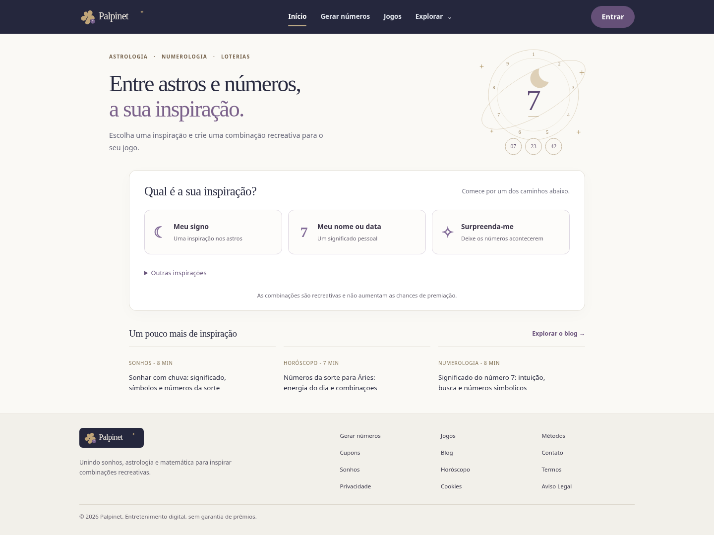

# Palpinet — uma experiência de inspiração

Uma interface limpa para criar combinações recreativas a partir do signo, do nome ou de uma data. Os métodos de sonhos, matemática e demais opções continuam em Outras inspirações. As regras de cada modalidade e de não repetição permanecem no gerador existente.

## Visualizar

Na branch `palpinet-ritual`, escolha **Code → Download ZIP** no GitHub e extraia o arquivo em uma pasta nova.

- **Offline:** abra `offline/Palpinet-offline.html` no Chrome ou Edge. Estilos, imagens e scripts estão incluídos. Interpretações por IA e contas sincronizadas dependem de serviços online e ficam indisponíveis nessa prévia.
- **Localhost:** abra `Visualizar.bat` na raiz. O inicializador procura também a instalação por usuário do Python 3.13 identificada no computador do usuário. Mantenha a janela do servidor aberta. A aplicação não exige instalação de pacotes para funcionar.

Para atualizar o HTML portátil depois de editar o projeto, execute `python build_offline.py`.

## O que mudou

- Três caminhos iniciais: Meu signo, Meu nome ou data e Surpreenda-me. Os campos aparecem depois da escolha.
- Alternância entre nome e data; os demais métodos permanecem disponíveis em um menu secundário.
- Copiar e Salvar em destaque. Nova geração, compartilhamento e e-mail continuam em Mais opções.
- Logotipo simplificado, mantendo trevo, nome e um número como elementos da marca. O arquivo anterior continua preservado.
- Fundo claro, roxo suave, lua e órbitas em traços finos; conteúdo secundário concentrado nas páginas próprias.

[Ver resultado](docs/ritual-resultado.png) · [Ver no celular](docs/ritual-celular.png)

## Contas e histórico

A integração com Supabase Auth e histórico por usuário está implementada, mas **ainda precisa de um projeto configurado e validação real**. Veja [as instruções de ativação](supabase/README.md). Não foram criados projetos, aplicadas migrações externas ou ativados serviços hospedados durante esta alteração.

O login com administrador pré-cadastrado e a recuperação local por conhecimento do e-mail foram removidos. Contas locais de teste usam hash com salt; elas continuam sendo uma prévia, não uma autenticação online. Em hospedagem pública, a configuração ausente impede o login em vez de usar a conta local como substituto.

## Verificações

Os testes de navegador precisam de Playwright e Chromium; não são dependências do site. Instale `tests/requirements.txt`, ajuste `PALPINET_TEST_URL` para seu servidor local e execute `python tests/browser_checks.py`. `PALPINET_CHROMIUM` permite indicar outro executável do navegador.

As políticas de acesso são exercitadas em PostgreSQL via PGlite: na pasta `tests`, execute `npm ci` e `npm run test:rls`. Isso verifica o isolamento entre usuários e a exclusão da própria conta, mas não substitui testes no projeto Supabase real.

A alteração está disponível para revisão. O site no Netlify não foi atualizado. As versões anteriores continuam nas respectivas branches.
