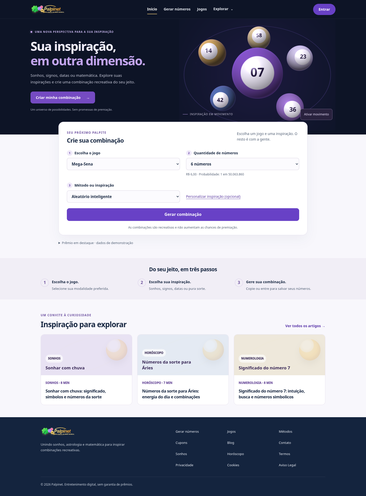

# Palpinet — versão reformulada para revisão

Código recuperado do ZIP original e reformulado para simplificar a home, a navegação e o gerador. Esta branch serve para revisão; o site do Netlify não foi atualizado.

## Baixar para o Windows

Na branch `palpinet-reformulado`, clique em **Code → Download ZIP**. Extraia o ZIP em uma pasta nova, preservando sua versão anterior.

## Visualizar sem internet

Abra `offline/Palpinet-offline.html` com Chrome ou Edge. O arquivo inclui estilos, imagens, navegação e geração local. As interpretações por IA e os links externos precisam de conexão. Esta é uma versão portátil para revisão, não o arquivo de publicação.

## Visualizar o projeto completo no localhost

Com Python 3 instalado, abra `Visualizar.bat` na raiz do projeto. Mantenha o terminal aberto enquanto navega. O servidor local suporta as rotas internas do site.

Consulte `REVISAO.md` para as mudanças, verificações e limitações. A autenticação e o histórico desta versão permanecem locais ao navegador; APIs e sincronização externa não foram ativadas.

## Proposta 3D (`palpinet-3d`)

[Ver prévia no celular](docs/previa-3d-celular.png)

A abertura usa uma cena WebGL com esferas, iluminação, movimento e resposta ao ponteiro. O gerador e as páginas internas mantêm o fluxo existente. Há pausa explícita, respeito à preferência por movimento reduzido e ilustração estática quando WebGL não está disponível. A animação para quando sai da tela ou a aba fica oculta. Não são usados modelos, bibliotecas ou texturas remotas.

Para atualizar o arquivo portátil depois de editar o projeto, execute `python build_offline.py`. O resultado é `offline/Palpinet-offline.html`.

A referência seacat.rossinavi.it retornou HTTP 403 neste ambiente. Esta é uma interpretação da direção imersiva solicitada, sem alegar reprodução dos detalhes da referência. A versão anterior permanece na branch `palpinet-reformulado`.
