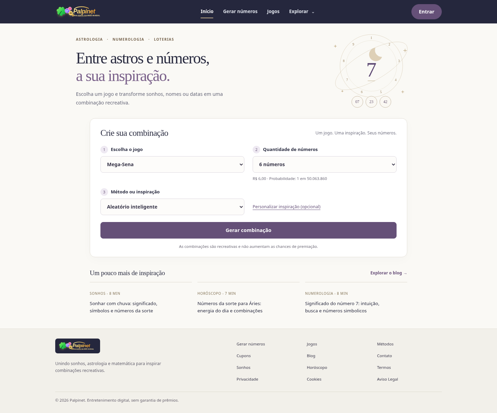

# Palpinet — proposta limpa para revisão

Código recuperado do ZIP original e reformulado para simplificar a home, a navegação e o gerador. Esta branch serve para revisão; o site do Netlify não foi atualizado.

## Baixar para o Windows

Na branch `palpinet-clean`, clique em **Code → Download ZIP**. Extraia o ZIP em uma pasta nova, preservando sua versão anterior.

## Visualizar sem internet

Abra `offline/Palpinet-offline.html` com Chrome ou Edge. O arquivo inclui estilos, imagens, navegação e geração local. As interpretações por IA e os links externos precisam de conexão. Esta é uma versão portátil para revisão, não o arquivo de publicação.

## Visualizar o projeto completo no localhost

Com Python 3 instalado, abra `Visualizar.bat` na raiz do projeto. Mantenha o terminal aberto enquanto navega. O servidor local suporta as rotas internas do site.

Consulte `REVISAO.md` para as mudanças, verificações e limitações. A autenticação e o histórico desta versão permanecem locais ao navegador; APIs e sincronização externa não foram ativadas.

## Direção visual

Fundo claro, roxo suave e pequenos detalhes dourados. Uma ilustração estática de lua, órbitas e números reúne astrologia, numerologia e loterias. A abertura é curta, o gerador permanece em destaque e o conteúdo complementar foi reduzido a três links de artigos. Os demais recursos continuam nas páginas internas.

[Ver modelo no celular](docs/modelo-limpo-celular.png)

As propostas anteriores permanecem nas branches `palpinet-reformulado` e `palpinet-3d`. Nenhuma publicação foi feita no Netlify. Para atualizar o HTML portátil depois de editar o projeto, execute `python build_offline.py`.
